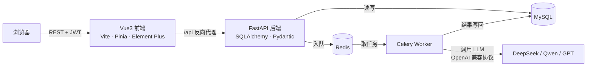

# AI 简历分析平台

基于 **FastAPI + Vue3** 的前后端分离项目：上传简历（PDF/Word），AI 从内容完整性、亮点与不足、岗位 JD 匹配度等维度生成结构化分析报告，支持历史记录与两次分析的对比。

## 功能特性

- **用户系统**：注册 / 登录 / JWT 无状态认证，分析记录按用户隔离
- **文件上传解析**：PDF（pdfplumber）/ Word（python-docx），扩展名白名单 + 大小限制 + 解析兜底三重校验
- **AI 分析**：内容完整性、亮点、不足、优化建议、岗位 JD 匹配打分；Prompt 强制 JSON 输出 + Pydantic 校验
- **异步架构**：Celery + Redis 任务队列，接口毫秒级返回，前端轮询任务状态
- **历史对比**：勾选两条已完成的分析，对比得分变化（▲/▼）与明细差异
- **一键部署**：docker compose 拉起 MySQL / Redis / 后端 / Worker / 前端 nginx 五个容器

## 技术栈

| 层 | 技术 |
|---|---|
| 后端 | FastAPI · SQLAlchemy 2.0 · Alembic · Pydantic v2 · PyMySQL · PyJWT · Celery |
| 前端 | Vue3 · Vite · TypeScript · Pinia · Vue Router · Axios · Element Plus |
| 基础设施 | MySQL 8 · Redis 7 · Docker Compose · Nginx |
| AI | OpenAI 兼容协议（DeepSeek / 通义千问 / OpenAI，`.env` 一键切换） |

## 架构



**一次分析的完整生命周期**：上传 → 解析文本入库（`pending`）→ 任务入队 Redis → Worker 取任务调 AI（`processing`）→ Pydantic 校验结果写回（`completed`）→ 前端轮询到完成态渲染报告。

## 快速开始（Docker，推荐）

```bash
git clone https://github.com/juicer139/airesume.git
cd airesume

# 1. 配置环境变量（两处）
cp .env.example .env                     # 填 MYSQL_ROOT_PASSWORD
cp backend/.env.example backend/.env     # 填 MYSQL_PASSWORD / AI_API_KEY / SECRET_KEY 等

# 2. 一键启动（首次需拉镜像）
docker compose up -d --build

# 3. 初始化数据库表（仅首次）
docker compose exec backend alembic upgrade head
```

打开 **http://localhost:8080** 注册账号即可使用。

> 注意：根目录 `.env` 的 `MYSQL_ROOT_PASSWORD` 必须与 `backend/.env` 的 `MYSQL_PASSWORD` 一致（业务使用 root 连接）。

## 本地开发

### 后端

```bash
cd backend
python -m venv venv && venv\Scripts\activate   # Windows
pip install -r requirements.txt
copy .env.example .env                         # 填写 MySQL / AI_API_KEY

# MySQL 中建库
# CREATE DATABASE airesume CHARACTER SET utf8mb4 COLLATE utf8mb4_unicode_ci;

alembic upgrade head
uvicorn app.main:app --reload                  # 接口文档: http://127.0.0.1:8000/docs
```

### 启动 Celery Worker（需本地 Redis，新开终端）

```bash
cd backend
celery -A app.core.celery_app worker --loglevel=info --pool=solo   # Windows 必须 --pool=solo
```

### 前端

```bash
cd frontend
npm install
npm run dev        # http://localhost:5173，/api 已配置代理到 8000
```

## 环境变量说明（backend/.env）

| 变量 | 说明 | 示例 |
|---|---|---|
| `MYSQL_HOST/PORT/USER/PASSWORD/DB` | 数据库连接 | `localhost:3306` |
| `SECRET_KEY` | JWT 签名密钥，生产必须换强随机值 | `python -c "import secrets; print(secrets.token_hex(32))"` |
| `AI_API_KEY` | AI 服务密钥（必填才能分析） | `sk-xxx` |
| `AI_BASE_URL` | OpenAI 兼容接口地址 | DeepSeek：`https://api.deepseek.com/v1`；通义：`https://dashscope.aliyuncs.com/compatible-mode/v1` |
| `AI_MODEL` | 模型名 | `deepseek-chat` / `qwen-plus` / `gpt-4o-mini` |
| `REDIS_URL` | Celery 消息队列 | `redis://localhost:6379/0` / `CELERY_RESULT_BACKEND=redis://localhost:6379/1` |
| `UPLOAD_DIR` | 简历文件存储目录 | `uploads` |

## API 概览

| 方法 | 路径 | 说明 |
|---|---|---|
| POST | `/api/users/register` | 注册 |
| POST | `/api/users/login` | 登录，返回 JWT |
| GET | `/api/users/me` | 当前用户信息 |
| POST | `/api/resumes/upload` | 上传简历（multipart，可附 JD） |
| GET | `/api/resumes` | 我的分析记录 |
| POST | `/api/resumes/{id}/analyze` | 创建异步分析任务（入队） |
| GET | `/api/resumes/{id}/status` | 轮询任务状态 |
| GET | `/api/resumes/{id}` | 分析报告详情 |
| GET | `/api/resumes/compare?ids=a,b` | 对比两条已完成分析 |
| DELETE | `/api/resumes/{id}` | 删除简历（软删除） |

完整交互文档见运行时的 `/docs`（Swagger UI）。

## 项目结构

```
airesume/
├── backend/
│   ├── app/
│   │   ├── api/            # 路由层：users / resumes
│   │   ├── core/           # 配置 / 数据库 / 安全 / Celery
│   │   ├── models/         # SQLAlchemy 模型
│   │   ├── schemas/        # Pydantic 模型（请求校验 + AI 输出校验）
│   │   ├── services/       # 业务逻辑：文件解析 / AI Provider + Prompt
│   │   ├── tasks/          # Celery 异步任务
│   │   └── main.py
│   ├── alembic/            # 数据库迁移
│   ├── tests/              # pytest（SQLite 内存库，离线可跑）
│   └── requirements.txt
├── frontend/
│   ├── src/
│   │   ├── api/            # axios 封装（双拦截器）
│   │   ├── router/         # 路由 + 登录守卫
│   │   ├── stores/         # Pinia（认证状态）
│   │   └── views/          # 上传 / 登录 / 注册 / 报告 / 对比
│   └── nginx.conf          # 生产 SPA 托管 + API 反代
├── docker-compose.yml
└── README.md
```

## 测试

```bash
cd backend
pytest    # 15 个用例，SQLite 内存库，无需 MySQL/Redis/AI Key
```

覆盖：注册/登录/JWT 保护、上传三重校验、docx 真实解析链路、跨用户越权隔离、对比接口参数与顺序。

## 安全设计

- bcrypt 密码哈希；登录失败统一提示，防撞库探测
- JWT 签名 + 过期校验；所有查询带 `user_id` 防水平越权（有测试锁定该行为）
- 上传：扩展名白名单 → 10MB 限制 → 解析兜底；uuid 重命名防路径穿越
- AI 返回内容视同不可信输入，Pydantic 校验通过才落库
- ORM 参数化查询防 SQL 注入；Vue 模板自动转义防 XSS
- 密钥只存 `.env`（已 gitignore），Docker 构建时同样排除（`.dockerignore`）

## 后续方向

- SSE 替代轮询、AI 结果流式输出
- 简历多版本管理与版本树
- RAG 岗位知识库匹配
- GitHub Actions CI（pytest + 前端构建检查）
